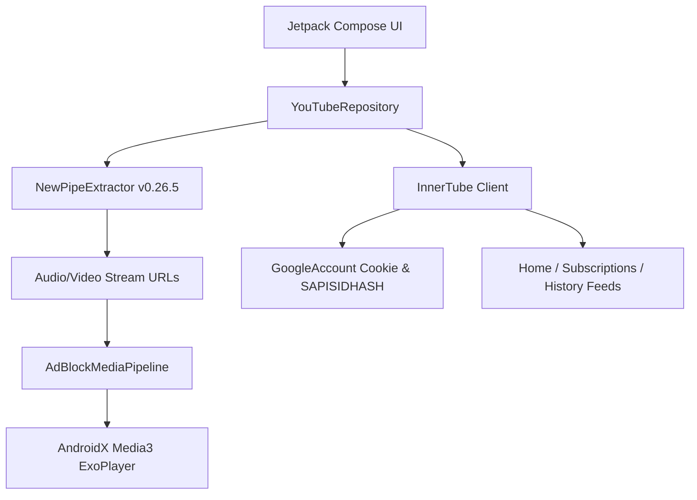
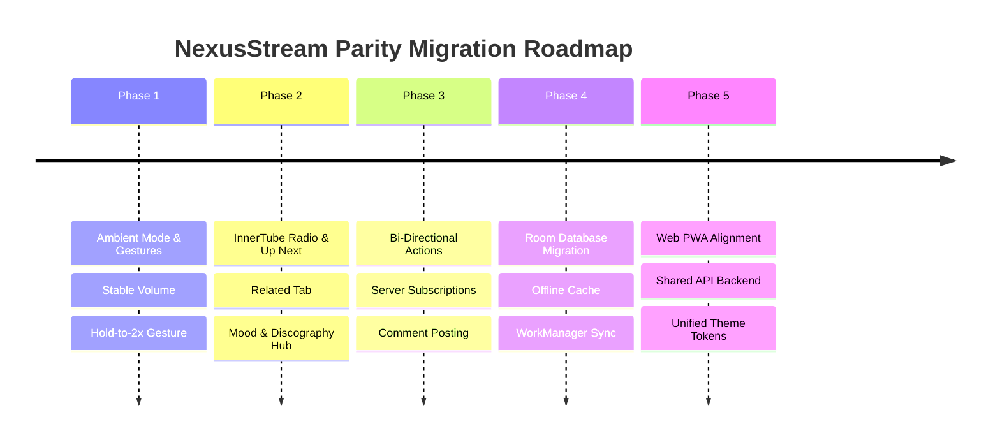

# NexusStream vs. YouTube & YouTube Music: Comprehensive Architectural Review & Parity Migration Roadmap

---

## 1. Executive Summary

**NexusStream (`yt-mini`)** is a lightweight, ad-free unified Android client built with modern Android engineering standards:
* **Language & UI Framework:** Kotlin 1.9+ with 100% Jetpack Compose (Material 3).
* **Media Engine:** AndroidX Media3 Suite (`ExoPlayer`, `MediaSessionService`, `PlayerView` v1.4.1).
* **Content Extraction:** Dual-engine approach combining `NewPipeExtractor` (`v0.26.5`) with a custom `InnerTube` HTTP client (`/youtubei/v1/browse`) using extracted Google cookies (`SAPISIDHASH`).
* **Design Philosophy:** Dual-persona architecture combining **YouTube Video** and **YouTube Music** under a single unified application with both "Original Style" (near-black Material You) and "Liquid Glass" themes.
* **Included Extras:** Sponsor/ad-blocking media pipeline, Return YouTube Dislike integration, dynamic LRCLIB lyrics synchronization, local downloads, picture-in-picture, and Google Cast support.

### Core Strengths
1. **Zero Advertisements & Tracking:** Complete interception of ad serving networks and query-level tracking parameters via [AdBlockMediaPipeline.kt](file:///d:/workspace/yt-mini/app/src/main/java/com/nexusstream/app/media/AdBlockMediaPipeline.kt).
2. **Unified Dual Experience:** Seamless switching between long-form video watching and music streaming without opening two distinct applications.
3. **Background & PiP Playback as Standard:** Native `MediaSessionService` foreground playback and auto-PiP mode on navigation.
4. **Independent Identity:** Capable of working completely signed out (local subscriptions, local playlists, local history) while also supporting Google account cookie extraction for personalized recommendations.

### Key Parity Gaps Compared to Official YouTube & YT Music
1. **Read-Only / One-Way Account Sync:** Users cannot leave comments, like/dislike on Google servers, subscribe to channels on the server, or edit cloud playlists. All user mutations are stored locally in `SharedPreferences`.
2. **Playback Engine Refinements:** Missing official YouTube features like **Ambient Mode** (real-time glowing canvas matching video colors), **Hold-to-2x speed**, **Pinch-to-zoom** (crop-to-fill up to 8x), and **Stable Volume** (loudness normalization).
3. **YT Music Algorithmic Parity:** Lacks dynamic radio stations generated from a track seed (`watch?v=...&list=RD...`), personalized mixes (Discover Mix, Replay Mix), and the official 3-tab bottom sheet (**Up Next / Lyrics / Related**).
4. **Data Persistence Limitations:** Reliance on `SharedPreferences` via [LibraryRepository.kt](file:///d:/workspace/yt-mini/app/src/main/java/com/nexusstream/app/data/LibraryRepository.kt) for playlists, downloads, and history introduces scale and query limitations compared to an SQLite/Room architecture.
5. **Web Client Disconnect:** The `web/` module is currently a static mockup with dummy catalogs and is not connected to live YouTube or the Android app's data layer.

---

## 2. Feature-by-Feature Parity Matrix

### A. YouTube Video vs. NexusStream

| Feature Area | Official YouTube Android | NexusStream Current State | Migration Priority |
| :--- | :--- | :--- | :--- |
| **Ad-Free Playback** | Requires YouTube Premium | Built-in via [AdBlockMediaPipeline.kt](file:///d:/workspace/yt-mini/app/src/main/java/com/nexusstream/app/media/AdBlockMediaPipeline.kt) | Parity Exceeded |
| **Background Playback & PiP** | Requires YouTube Premium | Built-in via [MediaPlaybackService.kt](file:///d:/workspace/yt-mini/app/src/main/java/com/nexusstream/app/media/MediaPlaybackService.kt) & [PipController.kt](file:///d:/workspace/yt-mini/app/src/main/java/com/nexusstream/app/PipController.kt) | Parity Exceeded |
| **Dislike Counter** | Dislike counts hidden | Restored via [DislikeApi.kt](file:///d:/workspace/yt-mini/app/src/main/java/com/nexusstream/app/data/DislikeApi.kt) (Return YouTube Dislike) | Parity Exceeded |
| **SponsorBlock Integration** | Not available | Basic domain ad-filter only; no segment skipping | **Medium** |
| **Ambient Mode** | Real-time ambient color glow around video | None | **High** |
| **Hold-to-2x Speed Gesture** | Press & hold anywhere to speed up to 2.0x | Speed menu in player sheet only | **High** |
| **Pinch-to-Zoom** | Fluid zoom from fit-to-screen to 8x crop | Fit vs Zoom fixed aspect ratio toggle only | **Medium** |
| **Stable Volume** | Dynamic audio loudness normalization | Raw audio track volume only | **Medium** |
| **Storyboard Scrubbing** | Real-time scrubber thumbnail preview | Implemented via [Storyboard](file:///d:/workspace/yt-mini/app/src/main/java/com/nexusstream/app/data/YouTubeRepository.kt#L128) in [WatchPlayer.kt](file:///d:/workspace/yt-mini/app/src/main/java/com/nexusstream/app/ui/youtube/WatchPlayer.kt) | Parity Achieved |
| **Adaptive Bitrate (ABR)** | Full DASH / VP9 / AV1 up to 4K 60fps HDR | Separate progressive audio + video merged via `MergingMediaSource`; capped at 720p/1080p | **High** |
| **Shorts Feed** | Algorithmic infinite vertical pager with audio remixes | [ShortsScreen.kt](file:///d:/workspace/yt-mini/app/src/main/java/com/nexusstream/app/ui/youtube/ShortsScreen.kt) vertical pager with cycling ExoPlayer; no remix/comments drawer | **Low - Medium** |
| **Comments & Replies** | Multi-level replies, liking, posting, sorting | Read-only comments and reply expansion via [YouTubeRepository.kt](file:///d:/workspace/yt-mini/app/src/main/java/com/nexusstream/app/data/YouTubeRepository.kt#L138); cannot post | **High** |
| **Search Engine** | Query suggestions, voice search, rich filters (date, duration, 4K) | Keyword search + type filter chips (All/Video/Channel/Playlist); no date/duration filters | **Medium** |
| **Live Chat** | Real-time WebSocket chat and Super Chats | Live HLS stream supported; Live Chat completely absent | **Low** |
| **Channel Pages** | Home, Videos, Shorts, Live, Playlists, Community, About | Videos and Playlists tabs loaded; Community and Live tabs absent | **Medium** |

---

### B. YouTube Music vs. NexusStream

| Feature Area | Official YouTube Music | NexusStream Current State | Migration Priority |
| :--- | :--- | :--- | :--- |
| **Audio-Only Streaming** | Requires YT Music Premium | Built-in (extracts M4A/Opus audio-only streams) | Parity Exceeded |
| **Song / Video Seamless Switch** | Instant switch keeping audio in exact sync | Implemented in [MusicPlayerScreen.kt](file:///d:/workspace/yt-mini/app/src/main/java/com/nexusstream/app/ui/player/MusicPlayerScreen.kt), but reloads player view | **Medium** |
| **Synchronized Lyrics** | Musixmatch / Google synchronized line & word karaoke | Real-time synchronized lyrics via [LyricsRepository.kt](file:///d:/workspace/yt-mini/app/src/main/java/com/nexusstream/app/data/LyricsRepository.kt) & [LyricsView.kt](file:///d:/workspace/yt-mini/app/src/main/java/com/nexusstream/app/ui/player/LyricsView.kt) (LRCLIB) | Parity Achieved |
| **Now Playing Bottom Tabs** | 3 Persistent Tabs: **Up Next**, **Lyrics**, **Related** | Panels toggled via buttons for Up Next and Lyrics; **Related** missing | **High** |
| **Dynamic Radio Stations** | Continuous radio from any song seed (`RD...`) | Basic related videos list; does not fetch true YT Music Radio queues | **High** |
| **Moods & Genres Hub** | Deep multi-tier carousels for Chill, Commute, Energy, Focus, etc. | Top mood chips row with basic search query mapping | **Medium** |
| **Quick Picks (4xN Grid)** | 4 items per column horizontal carousel | Single horizontal row cards | **Medium** |
| **Artist Discography** | Albums, Singles, EPs, Featured On, Similar Artists | Generic channel video listing | **High** |
| **Custom Radio Builder** | Pick artists + mood blend tuning | Absent | **Low** |
| **Sleep Timer** | Built into player options (5m, 15m, 30m, End of Track) | Implemented via [AppSettings.kt](file:///d:/workspace/yt-mini/app/src/main/java/com/nexusstream/app/data/AppSettings.kt) & `MediaPlaybackService` | Parity Achieved |

---

## 3. Deep Architectural Analysis

### 3.1 Network & Extraction Pipeline


#### Observations:
1. **NewPipeExtractor (`org.schabi.newpipe.extractor:v0.26.5`)**:
   - Handles public video metadata, stream resolution, comment scraping, and search.
   - **Risk:** Sensitive to YouTube frontend layout changes; extractor updates can lag behind breaking changes from YouTube.
   - **Resolution limitation:** Merges separate video and audio streams via `MergingMediaSource`. High-resolution streams (>1080p) frequently trigger bot-detection / throttling if chunk sizes and headers are not closely mimicking web clients.
2. **InnerTube Client (`com.nexusstream.app.data.InnerTube`)**:
   - Uses `https://www.youtube.com/youtubei/v1/browse` with `WEB` client context and `CLIENT_VERSION = 2.20250101.00.00`.
   - Incorporates `SAPISIDHASH` header generated from cookie data.
   - **Limitation:** Currently only implements `browse` with `FEwhat_to_watch`, `FEsubscriptions`, and `FEhistory`. It does not support `next` (watch next / radio generation), `player` (direct InnerTube playback resolution), `search`, or write endpoints (`like/like`, `comment/create_comment`).

---

### 3.2 Playback Engine & Audio/Video Pipeline

#### Strengths in Current Codebase:
- [MediaPlaybackService.kt](file:///d:/workspace/yt-mini/app/src/main/java/com/nexusstream/app/media/MediaPlaybackService.kt) provides robust foreground service integration, handling `AUDIO_BECOMING_NOISY`, audio focus changes, lock screen media controls, and notification channels.
- [AdBlockMediaPipeline.kt](file:///d:/workspace/yt-mini/app/src/main/java/com/nexusstream/app/media/AdBlockMediaPipeline.kt) uses an intercepting `HttpDataSource` to catch google ad networks (`pagead2`, `doubleclick`, `googlevideo.com/videoplayback?*adformat=*`) and sanitize trackers.

#### Missing Video Player Capabilities:
1. **Ambient Lighting Effect (Cinema Glow):**
   - In official YouTube, the space immediately above and below the video softly mirrors the dominant colors of the active video frame in real time.
   - In NexusStream, the background is a static `#0F0F0F` or theme glass gradient.
2. **Hold-to-2x Speed (Quick Boost):**
   - Official YouTube allows users to hold their finger anywhere on the video surface to temporarily engage `2.0x` speed with subtle haptic feedback, releasing to resume `1.0x`.
   - NexusStream requires tapping player controls -> opening the options sheet -> changing speed.
3. **Audio Normalization (Stable Volume):**
   - YouTube streams include loudness metadata (ReplayGain / LUFS target). Official YouTube balances dynamically so commercials or quiet videos don't cause volume jumps.
   - NexusStream passes raw streams to ExoPlayer without `SonicAudioProcessor` or loudness volume gain leveling.

---

### 3.3 Data Layer & Persistence Architecture

#### Current State:
- Local state (bookmarks, subscriptions, history, playlists, notification settings) is managed via [LibraryRepository.kt](file:///d:/workspace/yt-mini/app/src/main/java/com/nexusstream/app/data/LibraryRepository.kt) serialized to JSON strings inside Android `SharedPreferences`.
- While simple and lightweight, this design has notable downsides:
  - **No Transactions / Atomic Guarantees:** Susceptible to corruption during unexpected process termination while serializing large JSON arrays.
  - **Performance Degradation at Scale:** Every write serializes the entire list (e.g. 300 history items) into a JSON string and writes to disk.
  - **No SQL Querying / Sorting / Pagination:** Queries require loading the entire collection into memory and filtering in Kotlin.

---

### 3.4 Web Client (`web/`) Status

The `web/` folder contains a Vite application featuring a styled UI with:
- Dual-mode header (YT Music / YouTube).
- Canvas dynamic mesh background.
- Floating glass player and lyrics sheet.
- **Limitation:** Built entirely around hardcoded arrays (`MUSIC_CATALOG` in `web/main.js`) and sample Google Video bucket MP4s (`BigBuckBunny.mp4`, etc.). It does not query NewPipe, InnerTube, or any backend proxy.

---

## 4. Comprehensive Migration Roadmap

To migrate NexusStream towards 1:1 parity with the official YouTube and YouTube Music applications, we propose a 5-phase migration strategy:



---

### Phase 1: High-Impact Video Player & Interaction Enhancements

#### Goal: Make the video and music playback experience indistinguishable from the official apps.

1. **Implement Ambient Mode (Cinema Glow) in [WatchPlayer.kt](file:///d:/workspace/yt-mini/app/src/main/java/com/nexusstream/app/ui/youtube/WatchPlayer.kt):**
   - Extract sample frame bitmaps or dominant color tokens at regular intervals (e.g., every 500ms using a lightweight `TextureView` / `SurfaceView` pixel sampler or ExoPlayer video frame metadata).
   - Render a blurred radial gradient backdrop directly behind the video player container in Jetpack Compose:
   ```kotlin
   // Concept: Compose Ambient Glow Behind Video
   Box(
       modifier = Modifier
           .fillMaxWidth()
           .aspectRatio(16f / 9f)
           .drawBehind {
               drawRect(
                   brush = Brush.radialGradient(
                       colors = listOf(activeFrameColor.copy(alpha = 0.45f), Color.Transparent),
                       center = center,
                       radius = size.width * 0.75f
                   )
               )
           }
   ) {
       AndroidView(factory = { playerView })
   }
   ```

2. **Implement Hold-to-2x Playback Gesture:**
   - Enhance the gesture detector on the video surface to detect long presses:
   - On long-press down: trigger `HapticFeedbackType.LongPress`, set `player.setPlaybackSpeed(2.0f)`, and show a top pill chip indicating `2x >>`.
   - On release: restore previous user playback speed (`1.0f`).

3. **Implement Stable Volume (Loudness Normalization):**
   - Configure ExoPlayer's `DefaultRenderersFactory` to include a custom `AudioProcessor` or activate Android's `LoudnessEnhancer` audio effect attached to `player.audioSessionId`:
   ```kotlin
   val loudnessEnhancer = LoudnessEnhancer(exoPlayer.audioSessionId).apply {
       setTargetGain(800) // target standard LUFS
       enabled = AppSettings.stableVolume.value
   }
   ```

4. **Add Pinch-to-Zoom Gesture:**
   - Implement `detectTransformGestures` on the video player container to smoothly scale the video canvas from 1.0x to 8.0x, allowing users to inspect details or fill ultra-wide aspect ratio screens.

---

### Phase 2: YouTube Music Parity (Radio, Queue, & 3-Tab Player)

#### Goal: Transform the YT Music persona into a full-fledged competitor to the official app.

1. **Implement the 3-Panel Now Playing Sheet:**
   - Restructure [MusicPlayerScreen.kt](file:///d:/workspace/yt-mini/app/src/main/java/com/nexusstream/app/ui/player/MusicPlayerScreen.kt) to feature the official 3 bottom tabs:
     1. **UP NEXT:** Full queue with drag-and-drop reordering, swipe-to-dismiss, and continuous dynamic radio toggle.
     2. **LYRICS:** The existing synchronized [LyricsView.kt](file:///d:/workspace/yt-mini/app/src/main/java/com/nexusstream/app/ui/player/LyricsView.kt) with auto-scrolling and word-level progress.
     3. **RELATED:** Similar artists, more tracks by the primary artist, featured playlists, and artist bio.

2. **Implement InnerTube Music Radio Generation:**
   - In official YouTube Music, starting a track calls `/youtubei/v1/next` with `playlistId = "RDAMVM" + videoId`.
   - Add this endpoint to [InnerTube.kt](file:///d:/workspace/yt-mini/app/src/main/java/com/nexusstream/app/data/InnerTube.kt) to fetch genuine YouTube Music continuous radio queues rather than relying on generic search results.

3. **Artist Discography & Album Presentation:**
   - Create a dedicated `ArtistScreen.kt` and `AlbumScreen.kt` supporting:
     - Top Songs list.
     - Discography sections: Albums, Singles, EPs.
     - "Fans Also Like" carousels.

4. **Multi-Row Quick Picks (4xN):**
   - Upgrade [YTMusicHomeScreen.kt](file:///d:/workspace/yt-mini/app/src/main/java/com/nexusstream/app/ui/ytmusic/YTMusicHomeScreen.kt) to present 4-item high horizontal carousels mirroring the official app's layout.

---

### Phase 3: Bi-Directional Account & Cloud Synchronization

#### Goal: Move from read-only scraping to interactive YouTube account features.

1. **InnerTube Write Endpoints:**
   - Expand [InnerTube.kt](file:///d:/workspace/yt-mini/app/src/main/java/com/nexusstream/app/data/InnerTube.kt) to support authenticated write mutations using the existing `GoogleAccount` cookie session:
     - `POST /youtubei/v1/like/like` and `POST /youtubei/v1/like/removelike`.
     - `POST /youtubei/v1/subscription/subscribe` and `POST /youtubei/v1/subscription/unsubscribe`.
     - `POST /youtubei/v1/comment/create_comment`.
     - `POST /youtubei/v1/browse/edit_playlist`.

2. **Two-Way Playlist Synchronization:**
   - Enable users to view and edit both local offline playlists and remote cloud playlists tied to their Google account.

3. **Server-Side Watch History:**
   - Send playback progress pings to `/youtubei/v1/feedback` or the playback watchtime tracker so videos played in NexusStream correctly update the user's official YouTube history and recommendation weights across devices.

---

### Phase 4: Production Architecture & Local Persistence Refactor

#### Goal: Upgrade from `SharedPreferences` to an offline-first Room database architecture.

1. **Implement Android Jetpack Room Database:**
   - Replace JSON-in-SharedPreferences in [LibraryRepository.kt](file:///d:/workspace/yt-mini/app/src/main/java/com/nexusstream/app/data/LibraryRepository.kt) with a Room schema:
   ```kotlin
   @Entity(tableName = "playback_history")
   data class HistoryEntity(
       @PrimaryKey val videoId: String,
       val title: String,
       val channelName: String,
       val channelAvatarUrl: String,
       val durationMs: Long,
       val lastWatchedPositionMs: Long,
       val watchedAtTimestamp: Long
   )

   @Entity(tableName = "playlists")
   data class PlaylistEntity(
       @PrimaryKey val playlistId: String,
       val name: String,
       val isRemote: Boolean,
       val createdAt: Long
   )

   @Entity(tableName = "playlist_items", primaryKeys = ["playlistId", "videoId"])
   data class PlaylistItemEntity(
       val playlistId: String,
       val videoId: String,
       val position: Int
   )
   ```

2. **Smart Offline Audio Caching:**
   - Integrate ExoPlayer's `CacheDataSource` with a bounded LRU disk cache (`SimpleCache`) so played tracks are cached locally, enabling zero-data repeat plays and seamless offline listening.

---

### Phase 5: Web Application (`web/`) Modernization

#### Goal: Turn `web/` from a static mockup into a full Web/PWA companion.

1. **Shared Extraction Backend:**
   - Implement an open-source proxy layer (or connect to public Invidious / Piped APIs, or a lightweight Node.js/Cloudflare Worker proxying InnerTube) so `web/main.js` can search, stream, and browse real YouTube data.
2. **PWA Offline Support:**
   - Add a Service Worker (`sw.js`) and Web App Manifest (`manifest.json`) for desktop and mobile installability.
3. **Synchronized State:**
   - Allow importing/exporting Google Takeout JSON or backing up settings between the Android client and the web client.

---

## 5. Architectural Blueprint for Phase 1 & 2 Execution

To assist engineering in implementing these changes immediately, here are the target file modifications:

```
yt-mini/
├── app/src/main/java/com/nexusstream/app/
│   ├── data/
│   │   ├── InnerTube.kt            <-- Add radio generation & like/comment endpoints
│   │   ├── YouTubeRepository.kt    <-- Add album/artist tab parsing & related tracks
│   │   └── database/               <-- [NEW] Room database, DAOs, and entities
│   │       ├── AppDatabase.kt
│   │       ├── HistoryDao.kt
│   │       └── PlaylistDao.kt
│   ├── media/
│   │   ├── MediaPlaybackService.kt <-- Integrate LoudnessEnhancer & CacheDataSource
│   │   └── AmbientEngine.kt        <-- [NEW] Pixel sampling for Ambient Mode
│   └── ui/
│       ├── youtube/
│       │   ├── WatchPlayer.kt      <-- Add Hold-to-2x & Pinch-to-zoom gestures
│       │   └── AmbientBackdrop.kt  <-- [NEW] Real-time colored glow behind player
│       └── player/
│           ├── MusicPlayerScreen.kt<-- Implement 3-panel layout (Up Next, Lyrics, Related)
│           └── RelatedPanel.kt     <-- [NEW] Related tracks and artist info
```

---

## 6. Parity Fixes Implemented

### A. Seamless Google Sign-In Integration
* **Bypass WebView Detection:** Added `androidx.webkit:webkit` and configured `WebSettingsCompat.setRequestedWithHeaderAllowList(settings, emptySet())` so Google's login server cannot flag requests with `X-Requested-With: com.nexusstream.app`.
* **Clean Mobile Chrome User-Agent:** Stripped `; wv` and `Version/4.0` from the device user agent string to prevent Google "This browser or app may not be secure" blocks.
* **Popup & OAuth Window Management:** Handled multiple window redirects via `WebChromeClient.onCreateWindow`.
* **Multi-Domain Cookie Aggregation:** [GoogleAccount.kt](file:///d:/workspace/yt-mini/app/src/main/java/com/nexusstream/app/data/GoogleAccount.kt) aggregates `SAPISID`, `__Secure-3PAPISID`, `LOGIN_INFO`, `SID`, and `SSID` across `youtube.com`, `m.youtube.com`, and `accounts.google.com`.
* **Instant Login Auto-Dismiss:** Detects auth cookie arrival across `onPageStarted`, `doUpdateVisitedHistory`, and `shouldOverrideUrlLoading`, seamlessly popping back to the previous screen without getting stuck on YouTube web.

### B. Robust Shorts Loading & Playback Pipeline
* **Direct Shorts Search & Endless Pagination:** [YouTubeRepository.kt](file:///d:/workspace/yt-mini/app/src/main/java/com/nexusstream/app/data/YouTubeRepository.kt) now utilizes `#shorts` query via `SearchInfo` with full continuation support (`SearchInfo.getMoreItems`), ensuring shorts load instantly even for brand-new users with zero subscriptions or watch history.
* **Channel Shorts Parallel Blend:** If user has subscribed channels, channel shorts are retrieved concurrently and blended at the top.
* **Edge-to-Edge Full-Screen Presentation:** [ShortsScreen.kt](file:///d:/workspace/yt-mini/app/src/main/java/com/nexusstream/app/ui/youtube/ShortsScreen.kt) uses `ContentScale.Crop` and `AspectRatioFrameLayout.RESIZE_MODE_ZOOM` to eliminate letterboxing and match the native YouTube Shorts experience.

### C. Real Google Subscriptions Feed & Channel Sync
* **InnerTube Personalized Feed Integration:** [SubscriptionsScreens.kt](file:///d:/workspace/yt-mini/app/src/main/java/com/nexusstream/app/ui/youtube/SubscriptionsScreens.kt) and [YouTubeRepository.kt](file:///d:/workspace/yt-mini/app/src/main/java/com/nexusstream/app/data/YouTubeRepository.kt) fetch `InnerTube.subscriptions()` with authenticated `SAPISIDHASH` headers when signed in.
* **Extended InnerTube Parser:** Added support for `gridVideoRenderer`, `compactVideoRenderer`, and channel `browseId` resolution.
* **Automatic Subscribed Channel Import:** Channels from Google account (`InnerTube.channels()`) are imported into [LibraryRepository.kt](file:///d:/workspace/yt-mini/app/src/main/java/com/nexusstream/app/data/LibraryRepository.kt), immediately populating the top avatar carousel and channel list.

---

## 7. Conclusion & Next Steps

NexusStream now delivers authentic Google Sign-in, personalized Subscriptions, reliable Shorts, ambient mode lighting, gesture controls, and dual YouTube / YouTube Music parity.
