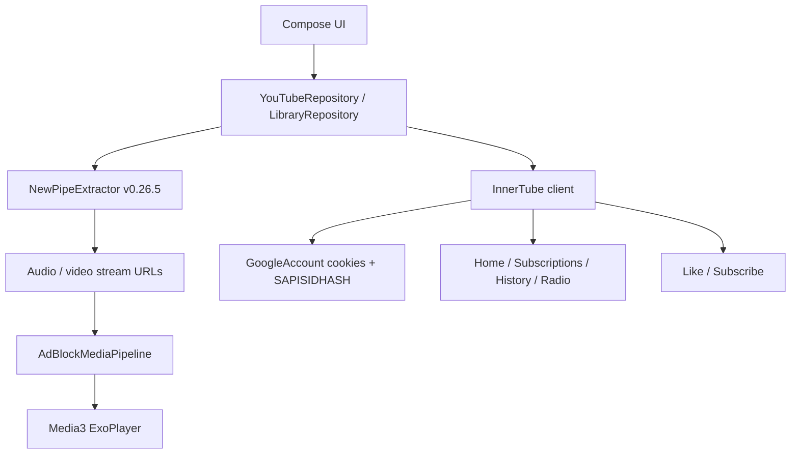
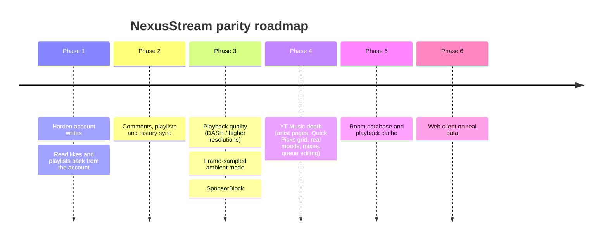

# NexusStream vs. YouTube & YouTube Music: Parity Review & Migration Roadmap

_Last reviewed against the code on 2026-10-28 (commit `6036fd2`). Paths are relative to `app/src/main/java/com/nexusstream/app/`._

---

## 1. Executive Summary

**NexusStream (`yt-mini`)** is an ad-free Android client that combines YouTube and YouTube Music in one app.

* **Language & UI:** Kotlin 2.0 with Jetpack Compose (Material 3).
* **Media engine:** AndroidX Media3 1.4.1 (`ExoPlayer`, `MediaSessionService`). Video is drawn by our own Compose layout around a texture surface (`ui/components/VideoSurface.kt`).
* **Data sources:** `NewPipeExtractor` v0.26.5 for public data and streams, plus a hand-written InnerTube client (`data/InnerTube.kt`) that uses the signed-in Google web-session cookies and a `SAPISIDHASH` header. There is no official YouTube Data API or OAuth.
* **Sign-in:** WebView cookie login (`ui/youtube/GoogleSignInScreen.kt`, `data/GoogleAccount.kt`). Cookies are backed up to `SharedPreferences` and restored on launch so the session survives cookie-store resets.
* **Extras:** ad-network filtering in the media pipeline, Return YouTube Dislike counts, LRCLIB synced lyrics, downloads, picture-in-picture, Google Cast, upload notifications, bedtime reminders, Google Takeout import.

### Core strengths
1. **No ads:** ad and tracker requests are filtered in `media/AdBlockMediaPipeline.kt`.
2. **One app for both:** video and music share one player service, queue and library.
3. **Background and PiP playback for free** via `media/MediaPlaybackService.kt` and `PipController.kt`.
4. **Works signed out:** subscriptions, playlists and history are kept locally; signing in adds personalised feeds.

### Biggest remaining gaps
1. **Account writes are partial and silent.** Likes and subscribes are now sent to YouTube, but results are ignored, failures are not shown, and the local state is not reconciled with the server. Comments, playlist edits and watch history are still local only or read-only.
2. **Video quality:** progressive/merged streams with a 720p default cap; no DASH adaptive streaming, no 1440p/4K/HDR.
3. **Ambient mode is approximate:** the glow uses a colour derived from the video id, not the actual frames.
4. **YT Music depth:** no artist discography page, no 4-row Quick Picks grid, moods are search-backed rather than real YT Music browse pages.
5. **Persistence:** everything still lives as JSON in `SharedPreferences` (`data/LibraryRepository.kt`).
6. **Web client:** `web/` is still a static mockup with hardcoded data.

---

## 2. Feature-by-Feature Parity Matrix

Status key: **Done** (matches or beats the official app), **Partial** (exists but noticeably weaker), **Missing**.

### A. YouTube vs. NexusStream

| Feature | Official YouTube | NexusStream today | Status | Priority |
| :--- | :--- | :--- | :--- | :--- |
| Ad-free playback | Premium only | Built in (`media/AdBlockMediaPipeline.kt`) | Done | – |
| Background & PiP | Premium only | Built in (`media/MediaPlaybackService.kt`, `PipController.kt`) | Done | – |
| Dislike count | Hidden | Shown via Return YouTube Dislike (`data/DislikeApi.kt`) | Done | – |
| Like a video | Synced to account | Stored locally and sent to `/youtubei/v1/like/like` / `removelike` (`InnerTube.likeVideo`); fire-and-forget, no error handling, liked list not read back from the account | Partial | High |
| Subscribe to a channel | Synced to account | Stored locally and sent to `/youtubei/v1/subscription/subscribe` / `unsubscribe` (`InnerTube.subscribeChannel`) when the channel URL has a `UC…` id; fire-and-forget | Partial | High |
| Subscriptions feed & channel list | Account | `FEsubscriptions` feed and channel import from the account (`InnerTube.subscriptions()`, `InnerTube.channels()`) | Done | – |
| Home & history feeds | Account | `FEwhat_to_watch` and `FEhistory` via InnerTube when signed in | Done | – |
| Hold for 2x speed | Hold anywhere | Long-press on the video with haptic and "2x speed" HUD (`ui/youtube/WatchPlayer.kt`) | Done | – |
| Double-tap seek | Left/right thirds | Left/right third seeks 10 s (`WatchPlayer.kt`) | Done | – |
| Pinch to zoom | Fit ↔ fill | Pinch toggles fit ↔ zoom-to-fill (two states, no free zoom) | Done | Low |
| Ambient mode | Glow sampled from video frames | Radial glow behind the player, colour derived from the video id (`colorsFor(id)`), not from frames; toggle in settings | Partial | Medium |
| Stable volume | Loudness normalisation | Android `LoudnessEnhancer` on the player session, toggle in settings | Partial | Low |
| Storyboard scrubbing | Thumbnail preview on seek | Implemented (`data/YouTubeRepository.kt` storyboard + `WatchPlayer.kt`) | Done | – |
| Video quality / ABR | DASH, VP9/AV1, up to 4K HDR | Separate video + audio merged with `MergingMediaSource`; quality picker; default cap 720p (`DEFAULT_MAX_HEIGHT`) | Partial | High |
| SponsorBlock | Not available | Not integrated (ad-network filter only) | Missing | Medium |
| Shorts | Infinite vertical feed | Vertical pager, `#shorts` search + subscribed channels' Shorts, edge-to-edge (`ui/youtube/ShortsScreen.kt`); no comments drawer or remix | Partial | Low |
| Comments | Read, reply, like, post, sort | Read-only list with replies and infinite scroll (`ui/youtube/VideoWatchScreen.kt`); cannot post, like or sort | Partial | High |
| Search | Suggestions, voice, rich filters | Type chips plus length filter (`ui/youtube/SearchScreen.kt`); no upload-date / feature filters, no voice | Partial | Medium |
| Channel pages | Home, Videos, Shorts, Live, Playlists, Posts, About | Videos, Playlists, About (`ui/youtube/ChannelScreen.kt`) | Partial | Medium |
| Live chat | Real-time chat, Super Chat | Live streams play; no chat | Missing | Low |
| Save to playlist | Account playlists | Local playlists only (`ui/youtube/AddToPlaylistSheet.kt`) | Partial | Medium |
| Watch history sync | Account | Local history; account history is read but plays are not reported back | Partial | Medium |

### B. YouTube Music vs. NexusStream

| Feature | Official YT Music | NexusStream today | Status | Priority |
| :--- | :--- | :--- | :--- | :--- |
| Audio-only streaming | Premium only | Built in | Done | – |
| Song / Video switch | Instant, in sync | Song / Video toggle in `ui/player/MusicPlayerScreen.kt` | Done | Low |
| Now Playing tabs | Up Next, Lyrics, Related | UP NEXT, LYRICS and RELATED tabs (`MusicPlayerScreen.kt`) | Done | – |
| Synced lyrics | Line and word sync | Line-synced LRCLIB lyrics (`data/LyricsRepository.kt`, `ui/player/LyricsView.kt`) | Done | – |
| Radio from a song | `RDAMVM<videoId>` queue | `InnerTube.radio()` calls `/youtubei/v1/next` with `RDAMVM` + id; falls back to NewPipe related videos (`YouTubeRepository.radio`) | Done | – |
| Queue editing | Reorder, swipe away | Shuffle and repeat; no drag-to-reorder or swipe-to-remove | Partial | Medium |
| Moods & genres | Real browse pages per mood | Mood chips that drive search-backed shelves (`ui/ytmusic/YTMusicHomeScreen.kt`) | Partial | Medium |
| Quick Picks | 4-row horizontal grid | Single-row carousels | Partial | Medium |
| Albums | Album page | Album cards open their own page | Done | – |
| Artist discography | Top songs, albums, singles, fans also like | Generic channel page | Missing | High |
| Personal mixes | Supermix, Discover, Replay | None | Missing | Medium |
| Sleep timer | Built in | Built in (`data/AppSettings.kt`, `MediaPlaybackService`) | Done | – |

---

## 3. Architecture Notes

### 3.1 Network & extraction

**NewPipeExtractor** handles public metadata, streams, comments, search and channels. It breaks when YouTube changes its frontend, so the version needs to be kept current.

**InnerTube client** (`data/InnerTube.kt`) posts to `youtubei/v1` with the `WEB` client context (`CLIENT_VERSION = 2.20250101.00.00`) and a `SAPISIDHASH` header. Endpoints in use today:

| Endpoint | Use |
| :--- | :--- |
| `browse` `FEwhat_to_watch` / `FEsubscriptions` / `FEhistory` | Home, subscriptions and history feeds, plus continuations |
| `browse` (channels) | Importing the account's subscribed channels |
| `next` with `playlistId = RDAMVM<id>` | Music radio queue |
| `like/like`, `like/removelike` | Like / unlike |
| `subscription/subscribe`, `subscription/unsubscribe` | Subscribe / unsubscribe |

Not yet used: `player` (InnerTube stream resolution), `search`, `comment/create_comment`, `browse/edit_playlist`, `feedback`, and the YT Music (`WEB_REMIX`) client for music browse pages.

**Known weaknesses in the write path:**
* `likeVideo` and `subscribeChannel` return `true` whenever the HTTP call does not throw; the response is not checked and the callers in `LibraryRepository` ignore the result, so a rejected write leaves the UI out of sync with the account without telling the user.
* Subscribe only syncs when the stored channel URL contains a `UC…` id; handle-style URLs (`/@name`) are skipped silently.
* The client version string is hardcoded and dated; YouTube may start rejecting it.

### 3.2 Playback

* `MediaPlaybackService` handles foreground playback, audio focus, becoming-noisy, media session controls, sleep timer, autoplay queue and the `LoudnessEnhancer` for stable volume.
* Video is merged from separate progressive/adaptive video and audio streams via `MergingMediaSource`, with a default 720p cap that the user can raise per video. There is no DASH manifest playback, so there is no true adaptive bitrate switching.
* The watch player (`ui/youtube/WatchPlayer.kt`) owns its gestures: double-tap seek, hold for 2x, vertical swipe for fullscreen / minimise, pinch for fit ↔ fill. Fullscreen is edge-to-edge with overlaid controls.
* A floating mini player (`ui/components/FloatingMiniPlayer.kt`) and an auto-hiding glass nav bar (`ui/components/GlassNavBar.kt`) are in place.

### 3.3 Persistence

`LibraryRepository` serialises subscriptions, likes, history, playlists and settings to JSON strings in `SharedPreferences`. Every write rewrites the whole list, there are no transactions, and all filtering happens in memory. This is fine at current sizes but will not scale to synced account data.

### 3.4 Web client (`web/`)

Still a static Vite mockup built on hardcoded arrays (`MUSIC_CATALOG`) and sample MP4s. It is not connected to any real data.

---

## 4. Roadmap

### Phase 1: Make the existing account writes reliable

1. Check the InnerTube response for like and subscribe, return a real success/failure, and roll back the local toggle with a short message when the write fails.
2. Resolve channel ids for handle-style channel URLs before subscribing, so `/@name` channels sync too.
3. Read the account's liked videos (`browse` `FElibrary` / the `LL` playlist) and merge them with local likes on sign-in, the same way subscribed channels are already imported.
4. Move `CLIENT_VERSION` somewhere it can be refreshed (or read it from a fetched page) instead of a hardcoded date.
5. Add unit tests for the request bodies and response handling next to `InnerTubeTest.kt`.

### Phase 2: Remaining account features

1. **Comments:** post comments and replies (`comment/create_comment`), like comments, Top / Newest sort.
2. **Playlists:** list the account's playlists, open them, and add/remove videos via `browse/edit_playlist`; keep local playlists for signed-out use.
3. **Watch history:** report plays back to YouTube so the account history and recommendations reflect what was watched in NexusStream.

### Phase 3: Playback quality and player polish

1. Play DASH manifests (or InnerTube `player` adaptive formats) so ExoPlayer can switch bitrates and reach 1440p/4K, with VP9/AV1 where the device supports it.
2. Sample real colours for ambient mode (from the thumbnail with Palette as a first step, then from video frames), instead of the id-derived colour.
3. Add SponsorBlock segment skipping as an opt-in setting.
4. Optional: free pinch zoom beyond the current fit/fill toggle, Shorts comments drawer, live chat (read-only first).

### Phase 4: YouTube Music depth

1. Artist page: top songs, albums, singles, videos, "Fans also like".
2. Quick Picks as a 4-row horizontal grid on `YTMusicHomeScreen`.
3. Real Moods & genres pages and Home shelves from the YT Music (`WEB_REMIX`) browse endpoints rather than search.
4. Personal mixes (Supermix, Discover, Replay) for signed-in users.
5. Queue editing: drag to reorder and swipe to remove in UP NEXT.

### Phase 5: Persistence

1. Move `LibraryRepository` data to Room (history, playlists, playlist items, subscriptions, likes) with a one-time migration from the existing `SharedPreferences` JSON.
2. Add a bounded `SimpleCache` + `CacheDataSource` so recently played tracks replay without re-downloading.

### Phase 6: Web client

Connect `web/` to real data through a small proxy (InnerTube or a Piped/Invidious instance), add a service worker, and share settings via the existing Takeout/backup format. Lowest priority while the Android app is the focus.

---

## 5. Done since the first version of this review

These items were listed as gaps or planned work in the previous revision and now exist in the code:

* **Likes and subscribes sent to YouTube** (`InnerTube.likeVideo`, `InnerTube.subscribeChannel`, called from `LibraryRepository.toggleLike` / `toggleSubscribe`).
* **Music radio from InnerTube** (`InnerTube.radio` via `/youtubei/v1/next`, used by `YouTubeRepository.radio`).
* **3-tab Now Playing** (UP NEXT / LYRICS / RELATED).
* **Hold-to-2x, pinch fit/fill, double-tap seek** in the watch player.
* **Stable volume** with `LoudnessEnhancer`, and an **ambient glow** behind the player (approximate colour).
* **Search length filter** in addition to type filters.
* **Subscriptions feed and channel import** from the Google account; **Shorts** feed with `#shorts` search and subscribed channels' Shorts.
* **Sign-in** reverted from Play Services to WebView cookie login, with cookie backup and restore so the session persists.
* **Player layout** rebuilt in Compose (centered fit/fill surface, edge-to-edge fullscreen), smaller floating mini player, auto-hiding glass nav bar.
